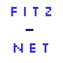
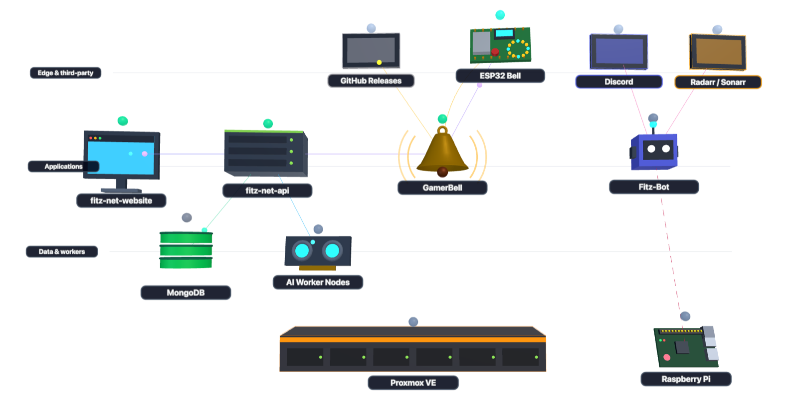
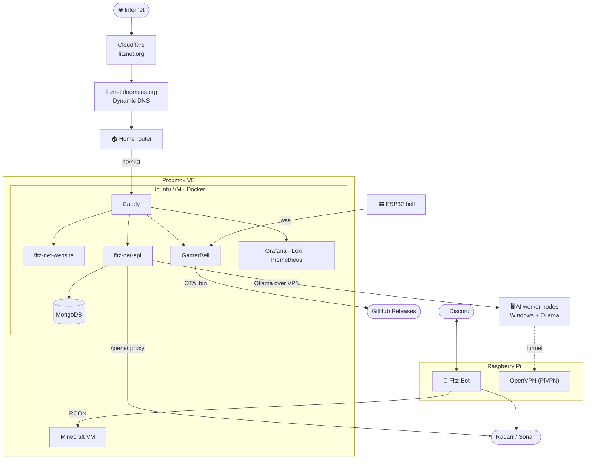

<a name="readme-top"></a>

<div align="center">
  <a href="https://fitznet.org">
    
  </a>

<h3 align="center">Fitz-Net</h3>

  <p align="center">
    A self-hosted platform for @mattlol85's ideas — running on bare metal, served to the internet.
    <br />
    <a href="https://fitznet.org">Live Site</a>
    ·
    <a href="https://github.com/mattlol85/Fitz-Net/issues">Report Bug</a>
    ·
    <a href="https://github.com/mattlol85/Fitz-Net/issues">Request Feature</a>
  </p>
</div>

[](https://fitznet.org/status)

<sub>The live architecture graph from the website's Status page.</sub>

## About

Fitz-Net is a personal full-stack platform running on a Proxmox box at home. It hosts:

- **Website** — React SPA with a LiveBoard (shared real-time canvas), a status dashboard with a 3D architecture graph, **Matt-GPT** (chat against self-hosted Ollama models), a Radarr/Sonarr admin panel, and permission-gated admin tools.
- **API** — Spring Boot REST + gRPC backend for users, permissions, AI chat and AI worker nodes.
- **AI worker nodes** — volunteer Windows GPUs that run Ollama, join over OpenVPN and register themselves with the API.
- **GamerBell + ESP32 bell** — a physical button that broadcasts presses to the site over WebSocket and updates its firmware over the air.
- **Fitz-Bot** — Discord bot for voice milestones, media requests and Minecraft whitelisting over RCON.
- **Observability** — Grafana, Loki, Promtail, Prometheus, cAdvisor and node-exporter, with a correlation ID traced through every request.

This repo is the **orchestration hub**: Docker Compose files, deploy scripts, the AI-node installer, cross-repo docs and the Claude Code agents/skills. Application code lives in the sibling repos.

## Architecture



Every Spring service exposes each REST endpoint as a gRPC RPC too (port 9090, internal network only). See [`docs/grpc.md`](docs/grpc.md) and [`docs/tracing.md`](docs/tracing.md).

## Repositories

| Repo | What it is |
|---|---|
| [Fitz-Net](https://github.com/mattlol85/Fitz-Net) | This repo — compose files, deploy scripts, AI-node installer, docs, Claude Code agents |
| [fitz-net-website](https://github.com/mattlol85/fitz-net-website) | React SPA served at [fitznet.org](https://fitznet.org) |
| [fitz-net-api](https://github.com/mattlol85/fitz-net-api) | REST + gRPC API: auth, permissions, AI chat, node enrollment, LiveBoard, Joenet proxy |
| [GamerBell](https://github.com/mattlol85/GamerBell) | WebSocket relay and OTA firmware server for the ESP32 bells |
| [Esp32FitznetBell](https://github.com/mattlol85/Esp32FitznetBell) | ESP32 bell firmware (OLED, captive-portal setup, OTA) |
| [Fitz-Bot](https://github.com/mattlol85/Fitz-Bot) | Discord bot — milestones, Radarr/Sonarr, Minecraft whitelist |

Each repo has a `.github/agents.md` with its own build commands and conventions.

## Built With

| Layer | Tech |
|---|---|
| **Frontend** |       |
| **Backend** |      -5865F2?style=flat-square&logo=discord&logoColor=white) |
| **AI** |    |
| **Hardware** |     |
| **Infra** |      |
| **Observability** |    |

## Getting Started

Copy `.env.example` to `.env`, fill it in, then bring up the core stack (Caddy, website, API, GamerBell, MongoDB):

```sh
cp .env.example .env
docker compose up -d
```

Observability runs as a separate stack:

```sh
cd observability
cp .env.example .env   # set GRAFANA_ADMIN_PASSWORD
docker compose up -d
```

To work on a single service, clone its repo and follow its README (`./gradlew bootRun`, `npm run dev`, `pio run`, …).

### Permissions

Users carry runtime-defined permissions (stored in Mongo; only `ADMIN` is built in) that the website uses to show tabs and the API enforces. Manage them from the website's `/admin` page, or with the `X-Admin-Key` header when `ADMIN_API_KEY` is set. There is no seeded admin — grant the first one with the key:

```sh
curl -H "X-Admin-Key: $ADMIN_API_KEY" -X POST https://<api>/admin/users/<user>/permissions/ADMIN
```

## Docs

| Doc | Covers |
|---|---|
| [`ai-chat-contract.md`](docs/ai-chat-contract.md) | Matt-GPT API contract between website and API |
| [`openvpn-ai-node-handoff.md`](docs/openvpn-ai-node-handoff.md) · [`scripts/ai-node-installer`](scripts/ai-node-installer/README.md) | Enrolling a GPU as an AI worker node |
| [`grpc.md`](docs/grpc.md) | REST → gRPC map and the "always both" rule |
| [`tracing.md`](docs/tracing.md) | Correlation IDs across HTTP, gRPC and WebSocket |
| [`joenet.md`](docs/joenet.md) | Radarr/Sonarr admin panel and proxy |
| [`fitz-bot.md`](docs/fitz-bot.md) | Fitz-Bot commands and Minecraft RCON setup |
| [`proxmox-self-hosted-runner-handoff.md`](docs/proxmox-self-hosted-runner-handoff.md) · [`scripts/proxmox`](scripts/proxmox/README.md) | Self-hosted runner and deploys |
| [`resource-limits.md`](docs/resource-limits.md) · [`mongo-auth-migration.md`](docs/mongo-auth-migration.md) | Container memory limits, Mongo auth |

## Claude Code

`.claude/` holds agents and skills for working across the six repos — e.g. `sync-siblings` (pull everything), `cross-repo-feature` (contract-first multi-repo changes), `ship-it` / `release-conductor` (PR → merge → tag → deploy) and `vulnScan`. Agent rules live in [`.github/agents.md`](.github/agents.md).

## Contributing

Branch as `feature/<name>`, use conventional commits (`feat(scope): …`, `fix(scope): …`, `chore(scope): …`) and open a PR against `main`.

## License

MIT — see [`LICENSE`](LICENSE).

<p align="right">(<a href="#readme-top">back to top</a>)</p>
